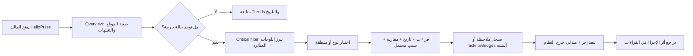
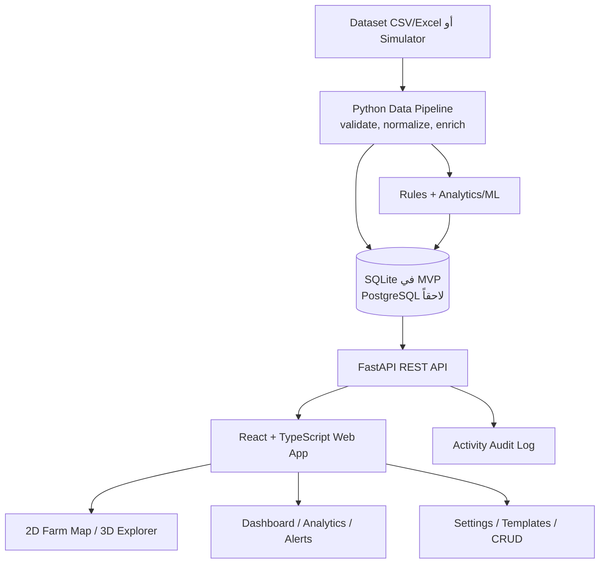

# HelioPulse — وثيقة اكتشاف المشروع والمواصفات الأولية

> **الحالة:** مسودة قرار (Draft)
> **الهدف:** توحيد فهم عبير والفريق قبل كتابة الـbackend أو اختيار نموذج الذكاء الاصطناعي.
> **قاعدة مهمة:** الموجود حالياً واجهة عرض تفاعلية فقط؛ ليس نظام مراقبة حقيقياً بعد. أي تقنية أو Model في هذه الوثيقة هي **مقترح قابل للتغيير** إلى أن نراجع الـdataset.

## 1) ملخص الفكرة

**HelioPulse** منصة ويب لمراقبة مزرعة ألواح شمسية افتراضية مكوّنة مبدئياً من **500 لوح (20 × 25)**. يفتح المالك لوحة تحكم واحدة فيرى صحة الموقع كاملة، ثم ينتقل إلى منطقة أو لوح محدد عند ظهور قراءة غير طبيعية. تحفظ المنصة القراءات التاريخية، تكشف الشذوذ/الأعطال المحتملة، وتعرض سبباً محتملاً وثقة التنبيه. لا تنفذ إصلاحاً فعلياً؛ قرار التنفيذ يبقى لصاحب المزرعة.

## 2) المشكلة التي يحلها

في مزرعة فيها مئات الألواح لا يمكن فحص كل لوح يدوياً كل دقيقة. المطلوب نظام يجيب بسرعة عن:

- هل الموقع يعمل طبيعياً الآن؟
- أين المشكلة تحديداً: صف/عمود/لوح/منطقة/عاكس؟
- ما الذي تغير، ومتى بدأ، وما السبب المحتمل؟
- هل الخلل مؤقت أم يتكرر؟ وهل توجد خطورة قادمة؟

## 3) المستخدم والنطاق

| بند | القرار الحالي |
|---|---|
| المستخدم الأساسي | مالك/مشغّل واحد بصلاحية Admin كاملة |
| تسجيل الدخول | خارج MVP حالياً؛ يضاف لاحقاً عند تعدد المستخدمين |
| مصدر البيانات | Dataset حقيقية + محاكٍ افتراضي؛ لا أجهزة حقيقية في MVP |
| المنصة | Web responsive: حاسوب، لوحي، هاتف |
| اللغة | يحددها اجتماع عبير: عربي أو إنجليزي أو ثنائي |
| الهدف الأكاديمي | مشروع ماجستير قابل للشرح والعرض والاختبار |

## 4) ما هو موجود الآن، وما ليس موجوداً

| الحالة | العنصر |
|---|---|
| متاح في prototype | خريطة 2D لـ500 لوح، مشهد 3D قابل للتحريك، اختيار لوح، Themes، بيانات Demo، تنبيهات وملاحظات محلية |
| غير منفذ بعد | قاعدة بيانات، استيراد Dataset، API، backend، تنبيهات حقيقية، Model، تسجيل مستخدمين، استضافة |
| لا نفترضه | أجهزة IoT أو تحكم فعلي بالمنظومة أو دقة إنتاجية مضمونة |

## 5) أهداف المشروع

### أهداف MVP

1. عرض صحة 500 لوح كل دقيقة من بيانات محاكاة أو Dataset مستوردة.
2. تحديد اللوح/المنطقة المتأثرة بصرياً في خريطة 2D واضحة.
3. إظهار آخر قراءة، التاريخ، والتنبيه/السبب المحتمل عند الضغط على اللوح.
4. تخزين واسترجاع البيانات التاريخية خلال نطاق زمني.
5. دعم حالات عطل Demo: غبار، ارتفاع حرارة، تظليل، انخفاض جهد/إنتاج، مشكلة عاكس، بيانات ناقصة.
6. Dashboard قابل للتخصيص بقوالب Widgets وحقول قابلة للإظهار/الإخفاء.

### أهداف لاحقة

- توقع خطر فشل أو تدهور أداء، لا مجرد كشف الحالة الحالية.
- تفسير التنبيه: مقارنة مع الألواح المجاورة/القيمة المتوقعة.
- Incident timeline، سجل صيانة، تقارير PDF/CSV، تنبيه بريد.
- مستخدمون وصلاحيات متعددة وربط أجهزة حقيقية.

### خارج النطاق حالياً

- التحكم الكهربائي الحقيقي أو فصل لوح فعلي.
- اعتماد تنبيه الذكاء الاصطناعي كقرار سلامة مستقل.
- ادعاء أن بيانات المحاكاة تمثل كل ظروف المواقع الحقيقية.

## 6) المتطلبات الوظيفية الأولية

| ID | المتطلب | أولوية |
|---|---|---|
| FR-01 | Dashboard يلخص عدد الألواح الطبيعية/تحذير/حرجة | MVP |
| FR-02 | خريطة 2D 20×25 مع ألوان حالة قابلة للنقر | MVP |
| FR-03 | بحث وفلترة بالحالة، المنطقة، الصف/العمود، والوقت | MVP |
| FR-04 | صفحة/لوحة جانبية للوح: آخر قراءة، تاريخ، أسباب، مقارنة بالجيران | MVP |
| FR-05 | حفظ قراءات تاريخية واستعراضها حسب الفترة | MVP |
| FR-06 | تنبيهات مع مستوى، وقت، سبب محتمل، حالة acknowledge/resolved | MVP |
| FR-07 | تشغيل سيناريوهات محاكاة وإظهار تأثيرها | MVP |
| FR-08 | CRUD للإعدادات، القوالب، Widgets، قواعد التنبيه، السيناريوهات والملاحظات | MVP |
| FR-09 | استيراد Dataset والتحقق من الأعمدة والوحدات والأخطاء | MVP |
| FR-10 | سجل نشاط يسجل الأوامر والتعديلات المهمة | MVP |
| FR-11 | Themes: Dark / Calm / Light مع حفظ اختيار المستخدم | MVP |
| FR-12 | 3D view اختياري للاستكشاف: orbit/pan/zoom/top-view | Enhancement |
| FR-13 | تصدير تقرير أو بيانات مرشحة | لاحقاً |
| FR-14 | إشعار بريد/Push | لاحقاً |

### قاعدة CRUD

CRUD تعني **Create, Read, Update, Delete**. تطبق على كائنات الإدارة (Widget، Template، Rule، Scenario، Note، Panel metadata). القراءات الخام المستوردة لا تُعدّل مباشرة؛ تحفظ كسجل تاريخي قابل للتتبع، ويعالج الخطأ عبر Import جديد أو علامة جودة بيانات.

## 7) طبقات القياس الصحيحة

لا نربط كل قراءة باللوح بلا تحقق. هذا يمنع نمذجة خاطئة.

| الطبقة | أمثلة قياسات |
|---|---|
| اللوح Panel | DC voltage/current/power، حرارة اللوح، كفاءة، اتساخ/تظليل تقديري |
| المنطقة Array/Zone | متوسط الأداء، مقارنة الألواح، نسبة الحالة |
| العاكس Inverter | AC output، frequency (Hz)، inverter status/error code |
| الموقع Site | irradiance، حرارة محيطة، رياح، مطر/غبار |
| البطارية BESS إن وجدت | SOC، charging/discharging، temperature، health |

## 8) تجربة الاستخدام المقترحة

### الشاشات الأساسية

1. **Overview:** KPI، حالة الموقع، trend، تنبيهات، quick filters.
2. **Farm map:** 2D هو العرض التشغيلي الأساسي؛ 3D عرض مساعد لا بديل عنه.
3. **Panel/Zone details:** أحدث القيم، رسم تاريخي، أقران/متوقع، alerts، notes.
4. **Analytics:** أداء، حرارة، طاقة، anomalies، تحليل حسب فترة.
5. **Alerts & incidents:** lifecycle، severity، owner note، resolution.
6. **Data & simulation:** استيراد dataset، quality checks، اختيار scenario/time playback.
7. **Dashboard builder:** قوالب جاهزة وإضافة/حذف/ترتيب widgets وحقول.
8. **Settings:** theme، units، alert rules، panel layout، retention، language.

## 9) السيناريوهات الافتراضية المطلوبة للعرض

| السيناريو | ما يتغير في Demo | النتيجة المرئية |
|---|---|---|
| غبار/اتساخ | انخفاض تدريجي في power/efficiency | Warning ثم مقارنة سلبية بالأقران |
| ارتفاع حرارة | Panel temperature فوق الحد | تنبيه حرارة وخطر تدهور |
| تظليل موضعي | ألواح متجاورة تقل إنتاجيتها | كتلة ملونة في الخريطة |
| عطل لوح | voltage/current/power غير منطقي أو صفر | Critical على لوح محدد |
| عطل عاكس | تراجع مجموعة + status/error code | تنبيه على inverter/zone لا panel فقط |
| بيانات ناقصة | timestamps أو قيم مفقودة | Data quality warning، لا تشخيص زائف |
| طقس قاسٍ | irradiance/ambient/rain تتغير | تفسير أن الانخفاض قد يكون بيئياً |

## 10) نموذج الذكاء الاصطناعي والتحليل — مقترح مرحلي

لا نختار Model باسم جميل قبل فحص البيانات. نبدأ بـbaseline يمكن تفسيره ثم نقارن.

| المرحلة | المقترح | متى يستخدم | المخرج |
|---|---|---|---|
| 0 | قواعد Threshold + validation | دائماً | تنبيه واضح وقابل للشرح |
| 1 | مقارنة بالـpeer/expected baseline | عند وجود ألواح/فترات قابلة للمقارنة | deviation score |
| 2 | Isolation Forest أو LOF | عند وجود قراءات كثيرة وقليل labels | anomaly score |
| 3 | تصنيف أعطال | فقط إن كان لدينا fault labels موثوقة | نوع عطل + confidence |
| 4 | Forecast/risk | فقط إن كان التاريخ كافياً وتعريف الفشل واضحاً | احتمال/خطر مستقبلي |

نستخدم Python و`pandas` للتحضير والتحليل، و`scikit-learn` كبداية. [وثائق scikit-learn عن outlier/novelty detection](https://scikit-learn.org/stable/modules/outlier_detection.html) تميّز بين بيانات التدريب التي قد تحوي شذوذاً وبين بيانات طبيعية نظيفة؛ لذلك نوع الـdataset يحدد المنهج، لا العكس.

**قاعدة التفسير:** كل alert ذكي يعرض: القيمة المرصودة، القيمة المتوقعة/أقرانه، السبب المحتمل، الثقة، وما الذي لا يعرفه النظام. لا يكتب «سبب مؤكد» إلا إذا كانت هناك قاعدة بيانات موثقة تدعمه.

## 11) التقنيات المقترحة ولماذا

| الطبقة | الاقتراح | السبب | القرار |
|---|---|---|---|
| Frontend | TypeScript + React + Vite | مكونات قابلة لإعادة الاستخدام، types، ecosystem قوي | مقترح |
| Visualization | 2D CSS/SVG + Three.js للـ3D | 2D سريع وعملي؛ 3D تفاعلي اختياري | Three.js موجود في prototype |
| Charts | مكتبة React تختار بعد تحديد أنواع الرسوم | لا نضيف dependency بلا حاجة | مؤجل |
| Backend | Python + FastAPI | قريب من ML/data، typed API، OpenAPI docs | مقترح |
| تحليل البيانات | pandas + scikit-learn | أدوات مناسبة لـdataset وbaseline ML | مقترح |
| قاعدة MVP | SQLite | مجانية، محلية، سهلة للعرض | مقترح |
| قاعدة لاحقة | PostgreSQL | أفضل لتعدد المستخدمين والزمنيات والـproduction | مؤجل |
| Testing | pytest للـAPI/data + browser tests للواجهة | تحقق من المنطق وتجربة المستخدم | مقترح |
| Version control | GitHub | توثيق، مراجعة، نسخ، CI مستقبلي | معتمد |

مراجع رسمية: [TypeScript](https://www.typescriptlang.org/docs/)، [React](https://react.dev/learn)، [FastAPI](https://fastapi.tiangolo.com/)، [PostgreSQL](https://www.postgresql.org/docs/current/).

## 12) المعمارية المقترحة (ليست نهائية)

## 13) واجهات API المقترحة

هذه عقود أولية؛ لا تُبنى قبل Data Dictionary.

| Endpoint | الاستخدام |
|---|---|
| `GET /api/panels` | قائمة الألواح وحالتها الحالية |
| `GET /api/panels/{id}` | تفاصيل لوح وmetadata |
| `GET /api/readings?from=&to=&panelId=` | قراءات زمنية مفلترة |
| `GET /api/alerts` / `PATCH /api/alerts/{id}` | عرض/تأكيد/حل التنبيهات |
| `POST /api/imports` | رفع dataset وفحصها |
| `GET /api/data-quality` | ملخص النقص والوحدات والأخطاء |
| `GET/POST/PATCH/DELETE /api/dashboards` | قوالب وتخصيص dashboard |
| `GET/POST/PATCH/DELETE /api/alert-rules` | قواعد التنبيه |
| `POST /api/scenarios/{id}/run` | تشغيل محاكاة Demo |
| `POST /api/commands` | أوامر افتراضية فقط مع audit log |

### هل نحتاج APIs خارجية؟

**لا في النسخة الأولى.** Dataset + Simulator كافيان. نضيف Weather API فقط إذا احتاجت عبير مقارنة الطقس الحي وكانت شروطه/تكلفته مناسبة. لا نعتمد API خارجي في العرض الأكاديمي حتى لا يتعطل بسبب مفتاح أو شبكة.

## 14) متطلبات غير وظيفية

| المجال | معيار ابتدائي |
|---|---|
| الأداء | عرض 500 لوح وتطبيق filter بسلاسة على جهاز عادي |
| التحديث | قراءة/محاكاة كل دقيقة، مع زر pause/time travel في demo |
| Responsive | تصميم مفيد من 360px إلى desktop |
| الوصولية | لوحة مفاتيح للـ2D map، labels، تباين ألوان لا يعتمد على اللون وحده |
| قابلية التخصيص | Widgets/fields/templates وقواعد alert قابلة للتعديل |
| الدقة | تمييز Demo/Real data، وحدات وtimestamps وquality flags واضحة |
| التتبع | audit log للـCRUD والأوامر الافتراضية وحالات alerts |
| الأمان | لا secrets في الواجهة؛ auth لاحقاً عند تعدد المستخدمين |
| النسخ الاحتياطي | export/import لقاعدة MVP أو نسخة database محلية |

## 15) التوثيق الذي سننشئه بعد اجتماع عبير

| الوثيقة | متى تبدأ | مدخلاتها |
|---|---|---|
| Software Requirements Specification | بعد إجابات الاستبيان | goals، scope، user flows |
| Data Dictionary | فور استلام dataset | الأعمدة، الوحدات، الجودة |
| arc42 Architecture | بعد اعتماد stack وdata flow | SRS + ADRs |
| Use cases وUser stories | مع SRS | أدوار ومسارات المستخدم |
| API/OpenAPI contract | قبل backend | entities + data dictionary |
| Model Card | بعد baseline وتجارب موثقة | data، metrics، limitations |
| Test Plan | قبل تنفيذ كل feature | acceptance criteria |
| ADRs | عند كل قرار كبير | بدائل وسبب الاختيار |

## 16) معايير النجاح في العرض

- استيراد dataset أو تشغيل simulator مع فحص بيانات واضح.
- ملاحظة حالة غير طبيعية من Overview ثم الوصول للوح/المنطقة خلال خطوات قليلة.
- عرض historical evidence وسبب محتمل بدلاً من لون فقط.
- اختبار على سيناريوهات عطل متعددة، منها بيانات ناقصة.
- Dashboard قابل للتخصيص فعلياً، لا مجرد mockup.
- توثيق صادق يوضح أن النتائج التنبؤية مرتبطة بجودة وكمية البيانات.

## 17) بوابة القرار قبل البرمجة الكاملة

لا ننتقل إلى architecture نهائية أو backend كامل قبل تأكيد هذه العناصر:

1. رابط/عينة الـdataset ورخصة استخدامها.
2. مستوى البيانات: panel أم inverter أم site، والتردد الزمني والوحدات.
3. وجود labels للأعطال من عدمه.
4. أول KPI/سؤال بحث تريد عبير إثباته.
5. لغة النظام وموعد العرض ومتطلبات المشرف.
6. هل العرض Local فقط أم نشر مجاني تجريبي.

**الخطوة التالية:** فتح [استبيان اجتماع عبير](02_ABEER_QUESTIONNAIRE_AR.md)، تعبئة ما تعرفونه، ثم نحول الإجابات إلى SRS وData Dictionary وarc42 وimplementation plan.
